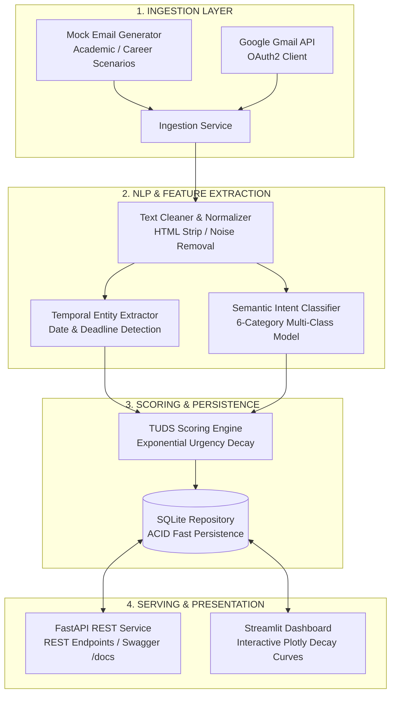

# 📬 Smart Personalized Email Prioritization System

[](https://www.python.org/)
[](https://fastapi.tiangolo.com)
[](https://streamlit.io)
[](https://docs.pydantic.dev/)
[](https://docs.pytest.org)
[](https://opensource.org/licenses/MIT)

An intelligent, event-driven email prioritization and management platform that dynamically ranks emails using **Temporal Urgency Decay Scoring (TUDS)**, multi-class semantic intent classification, and automated deadline entity extraction.

---

## 🌟 The Core Problem & Solution

Traditional email clients (Gmail, Outlook) prioritize incoming messages statically based on sender flags or arrival timestamps. This fails in time-critical academic and professional environments where **urgency is dynamic**:
- An internship application received 30 days before the deadline is low urgency initially.
- As the deadline approaches (within 24–48 hours), its urgency surges non-linearly.
- Once the deadline passes, urgency drops to near zero.

This system introduces **Temporal Urgency Decay Scoring (TUDS)**, an exponential decay model that dynamically re-ranks inboxes in real-time based on temporal proximity, user interest, and semantic category relevance.

---

## 📐 Mathematical Formulation: TUDS

The priority score $P(t)$ of an email at time $t$ before its deadline is defined by:

$$P(t) = (R \times I) \times \left(1 + \alpha e^{-\lambda t}\right)$$

Where:
- **$R \in [0.0, 1.0]$ (Category Relevance):** Base relevance determined by semantic intent (e.g., Placement $= 0.95$, Exam $= 0.90$, Internship $= 0.85$, Scholarship $= 0.80$, Event $= 0.60$, General $= 0.40$).
- **$I \in [0.0, 1.0]$ (User Interest Weight):** Personalized user affinity for categories and senders.
- **$t$ (Time Proximity):** Time remaining before the deadline in days ($t = \frac{\text{hours}}{24.0}$).
- **$\alpha$ (Amplification Magnitude):** Controls the scale of urgency amplification near the deadline (default $\alpha = 1.5$).
- **$\lambda$ (Exponential Decay Rate):** Category-specific decay factor regulating how rapidly urgency spikes (e.g., $\lambda_{\text{exam}} = 0.07$, $\lambda_{\text{placement}} = 0.06$).

### Temporal Boundary Conditions:
- **Active Deadline ($t > 0$):** Priority score escalates exponentially as $t \to 0$.
- **No Deadline Mentioned:** Urgency component is neutral $\to P(t) = R \times I$.
- **Deadline Passed ($t \le 0$):** Score decays to minimal archive relevance ($P(t) \to R \times I \times 0.25$) and is tagged as expired.

---

## 🏗️ System Architecture



---

## ✨ Features

- **🎯 6 Multi-Class Categories:** Placement, Internship, Exam, Scholarship, Event, General.
- **⏰ Smart Temporal Extractor:** Automatically identifies deadlines from natural language (`"last date to apply is..."`, `"apply before..."`, `"scheduled on..."`).
- **📈 Interactive Plotly Decay Curves:** Visualizes the dynamic exponential curve of priority vs. days remaining in real-time.
- **🎛️ Live TUDS Parameter Tuning:** Adjust $\alpha$, $\lambda$, and user interest weights $I$ via UI sliders to re-calculate and re-rank the entire inbox instantly.
- **🔥 Color-Coded Urgency Tiers:** Urgent (🔥), High (⚡), Medium (⏳), Low (📁).
- **⭐ Full Mailbox Management:** Move emails between Priority Inbox, Saved Bookmarks, and Trash.
- **🔌 Dual Ingestion Modes:**
  - `mock`: Instant rich academic/career email simulation targeting `sarathybhas@gmail.com` with dynamic deadlines relative to current time.
  - `gmail`: Live Google Gmail API OAuth2 integration (toggleable with zero code changes).

---

## 🚀 Quick Start

### 1. Prerequisites
- Python 3.12 or 3.13
- Git

### 2. Clone & Setup Virtual Environment
```bash
git clone https://github.com/your-username/smart-email-prioritization.git
cd smart-email-prioritization

# Create and activate virtual environment
python -m venv .venv
# On Windows:
.venv\Scripts\activate
# On Linux/macOS:
source .venv/bin/activate

# Install modern dependencies
pip install -r requirements.txt
```

### 3. Configure Environment
```bash
cp .env.example .env
```
*(By default, `INGESTION_SOURCE=mock` is enabled for zero-setup demo).*

### 4. Run the Streamlit Dashboard
```bash
streamlit run frontend/streamlit_app.py
```
Open **`http://localhost:8501`** in your browser.

### 5. Run the FastAPI REST Service (Optional)
```bash
uvicorn api.main:app --reload --port 8000
```
- Interactive OpenAPI Docs: **`http://127.0.0.1:8000/docs`**
- Health Check: **`http://127.0.0.1:8000/health`**

---

## 🐳 Docker Deployment

Run both the REST API and Streamlit Dashboard with a single command:
```bash
docker compose up --build
```
- Dashboard: `http://localhost:8501`
- REST API: `http://localhost:8000/docs`

---

## 🧪 Automated Test Suite

Run unit and integration tests across all modules:
```bash
pytest -v
```

```text
tests/test_api.py::test_health_check PASSED
tests/test_api.py::test_list_emails PASSED
tests/test_api.py::test_recompute_priorities PASSED
tests/test_classifier.py::test_classify_placement PASSED
tests/test_classifier.py::test_classify_internship PASSED
tests/test_classifier.py::test_classify_exam PASSED
tests/test_classifier.py::test_classify_scholarship PASSED
tests/test_classifier.py::test_classify_general PASSED
tests/test_cleaner.py::test_parse_sender_standard PASSED
tests/test_cleaner.py::test_clean_text_preserves_deadline_formatting PASSED
tests/test_entity_extractor.py::test_extract_keyword_deadline PASSED
tests/test_entity_extractor.py::test_extract_expired_deadline PASSED
tests/test_tuds_engine.py::test_tuds_urgency_increases_as_deadline_approaches PASSED
tests/test_tuds_engine.py::test_tuds_expired_deadline_decays PASSED
======================== 19 passed in 2.17s ========================
```

---

## 📂 Project Structure

```text
smart-email-prioritization/
├── api/
│   ├── routes/
│   │   ├── emails.py             # REST endpoints for emails and TUDS recomputation
│   │   └── ingestion.py          # Ingestion sync and demo reset endpoints
│   └── main.py                   # FastAPI application entrypoint
├── core/
│   ├── config.py                 # Pydantic Settings configuration loader
│   ├── models.py                 # Pydantic v2 schemas and models
│   └── logger.py                 # Structured logging
├── frontend/
│   └── streamlit_app.py          # Modern Streamlit UI with Plotly TUDS curves
├── ingestion/
│   ├── base.py                   # Abstract Ingestion Provider interface
│   ├── mock_generator.py         # Realistic academic email generator (sarathybhas@gmail.com)
│   ├── gmail_connector.py        # Official Google Gmail API OAuth2 connector
│   └── service.py                # Pipeline orchestrator
├── processing/
│   ├── cleaner.py                # Text normalization and sender parsing
│   ├── entity_extractor.py       # Temporal deadline parser (dateutil + regex)
│   └── classifier.py             # Multi-class semantic intent classifier
├── storage/
│   └── repository.py             # SQLite persistence layer with CRUD & analytics
├── tuds/
│   ├── engine.py                 # Mathematical TUDS formula engine
│   └── decay_curve.py            # Dynamic 2D curve data generator for Plotly
├── tests/                        # 19 automated test suites
├── Dockerfile                    # Production container build
├── docker-compose.yml            # Multi-service container orchestration
├── requirements.txt              # Modern 2026 production dependencies
└── README.md                     # Comprehensive project documentation
```

---

## 👤 Author & Portfolio

**Sarathy B**  
- Email: `sarathybhas@gmail.com`  
- Core Focus: Data Engineering, AI Systems, Distributed Architectures
